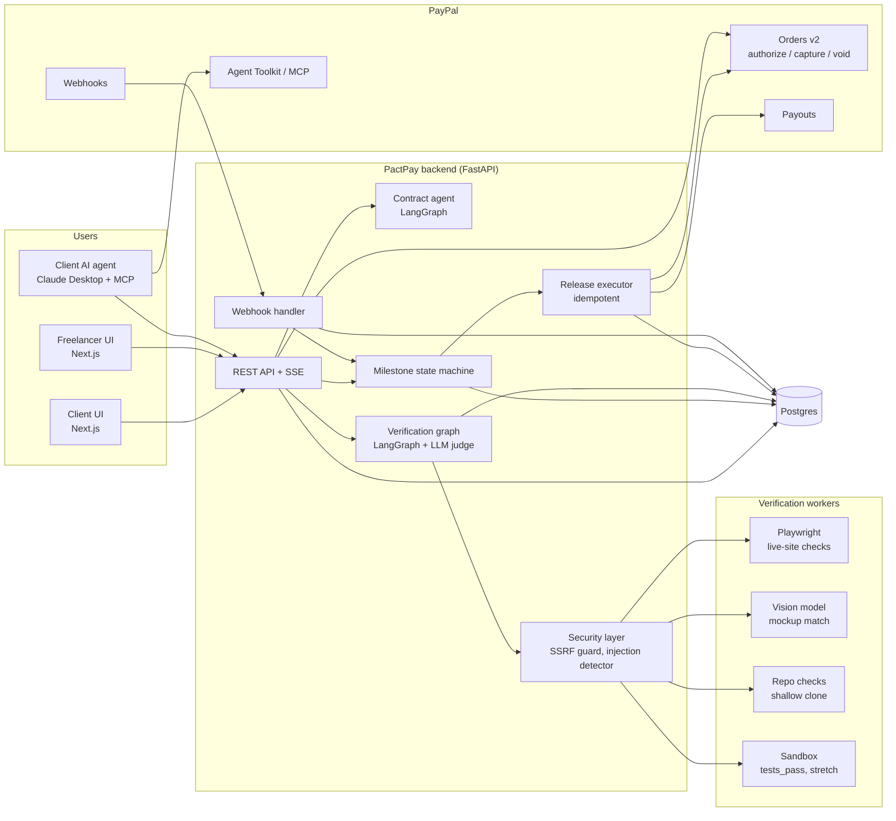
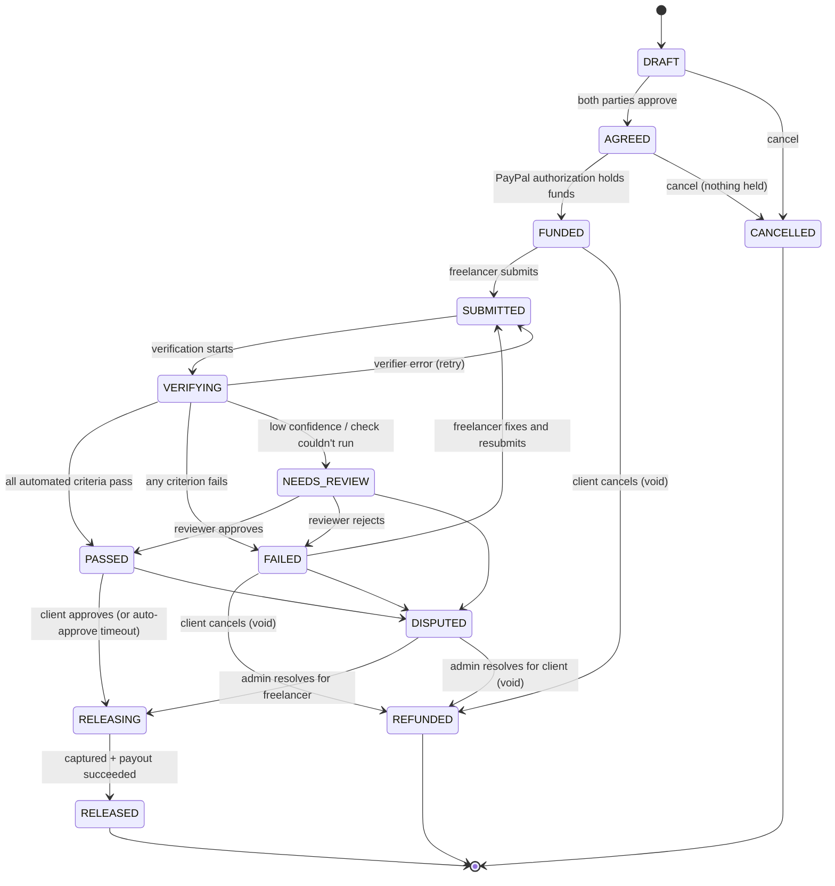

# PactPay Architecture

PactPay is AI-verified escrow for freelance work. The client's payment is **authorized** (held by
PayPal, not captured) up front, an AI verification engine checks the delivered work against
objectively checkable acceptance criteria and records evidence, and PactPay tells PayPal to **capture**
the payment and **pay out** the freelancer when the work passes. PactPay never holds money itself; it
only triggers capture, void and payout.

## System diagram

Key boundaries:

- **Only the release executor moves money**, and only after the state machine allows it. AI agents
  never call capture or payout directly.
- **Everything a freelancer submits is untrusted** (site HTML, repo files, README, images). It flows
  through the security layer, and the judge decides only from structured check results.
- **Webhooks are the source of truth** for payment state; the executor reconciles against them.

## Milestone state machine

Additions to the pack's state list:
- `NEEDS_REVIEW`: low-confidence verdicts get an explicit home instead of being forced into PASSED/FAILED.
- `RELEASING`: capture and payout are two PayPal calls. If capture succeeds and payout fails (we hit
  this in sandbox with a country restriction), the milestone stays here and the payout is retried
  idempotently instead of pretending the money arrived.
- `CANCELLED`: cancelled before any money was held (distinct from `REFUNDED`, which voids a hold).

Every transition is defined in `backend/app/workflows/milestone_state.py` with the roles allowed to
trigger it and a guard (e.g. no release without a PayPal authorization; no refund after capture).

## Money flow (PayPal)

| Step | PayPal API | Effect |
|---|---|---|
| Fund | `POST /v2/checkout/orders` (`intent=AUTHORIZE`) | Creates order, returns approval link |
| Client approves | PayPal checkout (redirect / JS SDK) | Buyer consents |
| Hold | `POST /v2/checkout/orders/{id}/authorize` | Funds held on buyer's account |
| Release | `POST /v2/payments/authorizations/{id}/capture` | Money moves to platform account |
| Pay freelancer | `POST /v1/payments/payouts` | Amount minus platform fee to freelancer |
| Cancel | `POST /v2/payments/authorizations/{id}/void` | Hold released |
| Long milestones | `POST /v2/payments/authorizations/{id}/reauthorize` | Renew hold after honor period |
| Reconcile | Webhooks + `verify-webhook-signature` | Confirms state changes |

Authorization timing (verify current values on developer.paypal.com before relying on them): an
authorization is typically guaranteed for a 3-day honor period and valid for up to 29 days. Milestones
longer than the honor period need a reauthorize or a re-fund; the executor handles both.

## Plan to 12 Nov evening (IST)

| Day | Date | Module | Priority |
|---|---|---|---|
| 1 | 2 Nov | M1 foundations, M2 PayPal client + orders | MUST |
| 2 | 3 Nov | M2 payouts + webhooks, sandbox end-to-end script | MUST |
| 3 | 4 Nov | M3 contract agent | MUST |
| 4 | 5 Nov | M4 Playwright checks, demo sites | MUST |
| 5 | 6 Nov | M4 visual + repo checks, M5 verification graph + judge | MUST |
| 6 | 7 Nov | M6 persistence + state machine, M7 API + SSE | MUST |
| 7 | 8 Nov | M7 release executor, M8 security | MUST |
| 8 | 9 Nov | M9 evals; mediator agent | MUST / STRETCH |
| 9 | 10 Nov | M10 frontend, M11 deploy; agentic hiring via MCP | MUST / STRETCH |
| 10 | 11 Nov | README, video script, recording | MUST |
| 11 | 12 Nov | Devpost submission, buffer | MUST |

Cut order if behind: agentic hiring → mediator → `tests_pass` sandbox → visual match.
